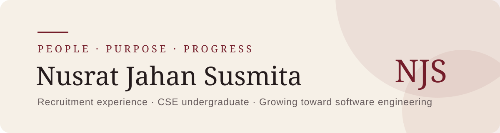

### Hello, I’m Nusrat.

I am a people-focused technology professional with experience in recruitment, candidate support, communication, and organized digital workflows. Alongside that experience, I am studying Computer Science and Engineering and building a foundation for a future in software engineering.

[](https://nusrat-jahan-susmita.vercel.app)
[](https://www.linkedin.com/in/nusrat-jahan--susmita)
[](mailto:susmitaa.9600@gmail.com)

---

## 01 / At a glance

| What shapes my work | Where I am heading |
| --- | --- |
| Thoughtful communication | A career connecting people and technology |
| Organized, dependable execution | A growing software-engineering foundation |
| Positive candidate experiences | Meaningful, human-centered problem solving |
| Leadership through service | Continuous learning and improvement |

> I believe the best work begins with understanding people, communicating clearly, and approaching every challenge with intention.

## 02 / My journey

**HR Executive · Project Youth JP**  
Supported candidate interviews, assessment, scheduling, follow-up communication, selection discussions, and confidential record management.

**Social Media Manager · Project Youth JP**  
Coordinated content and audience-facing communication across Facebook, Instagram, LinkedIn, and YouTube.

**Leadership & community involvement**  
Developed discipline, teamwork, coordination, and service through Girls Guide, Rover Scout, and Red Crescent Society activities.

## 03 / What I bring

| People & recruitment | Communication & organization | Technology & digital tools |
| --- | --- | --- |
| Candidate interviewing | Professional communication | Google Workspace |
| Structured questioning | Active listening | Microsoft Office |
| Candidate assessment | Team coordination | Trello |
| Interview coordination | Organized documentation | Meta Business Suite |
| Follow-up communication | Confidential data handling | Canva & Adobe Photoshop |

## 04 / Learning in progress

```text
Computer Science & Engineering
        ↓
Technical foundations + problem-solving
        ↓
Software engineering
        ↓
Technology built with human understanding
```

I am currently completing a **BSc in Computer Science and Engineering** at the University of Liberal Arts Bangladesh, with expected completion in late 2028.

## 05 / A little more about me

```javascript
const nusrat = {
  basedIn: "Dhaka, Bangladesh",
  qualities: ["Professional", "Dependable", "Ambitious", "Energetic"],
  languages: ["Bangla", "English"],
  growingToward: "Software Engineering",
  guidingThought: "Learn with purpose. Grow with intention."
};
```

---

<p align="center">
  <strong>People · Purpose · Progress</strong><br />
  <sub>Open to thoughtful conversations about recruitment, technology, and learning.</sub>
</p>
